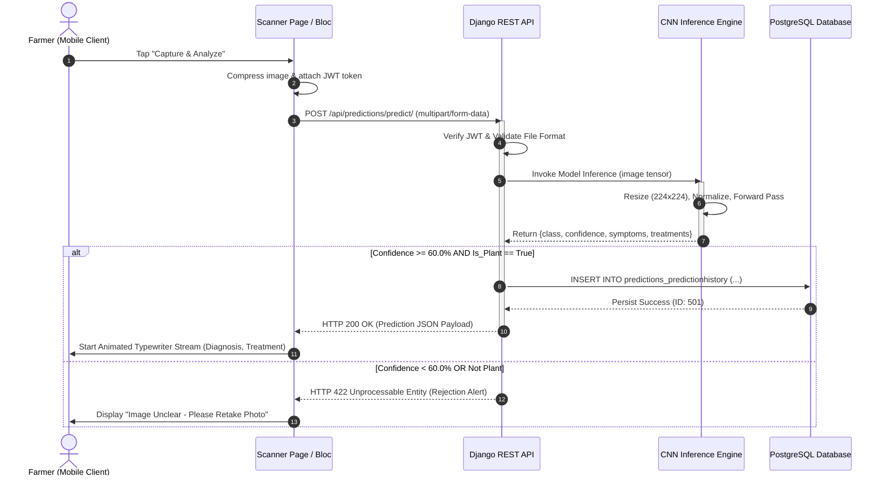
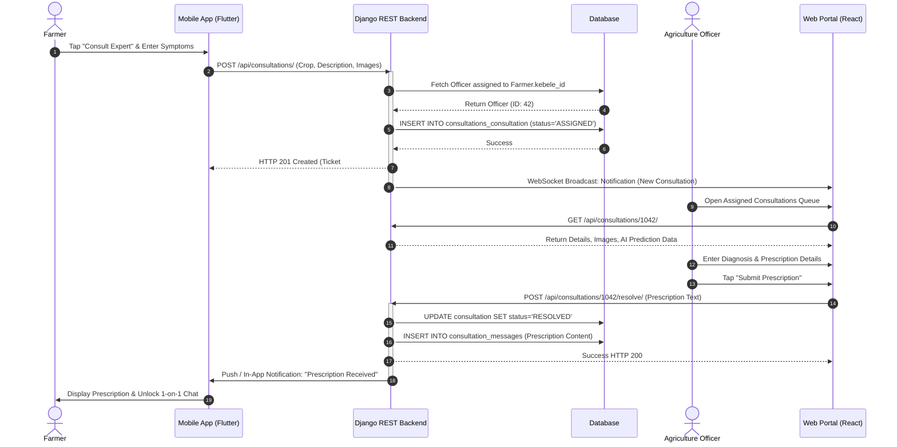
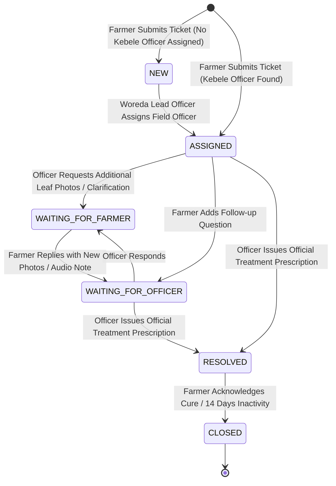
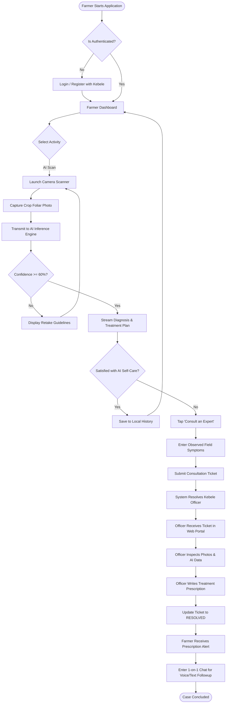
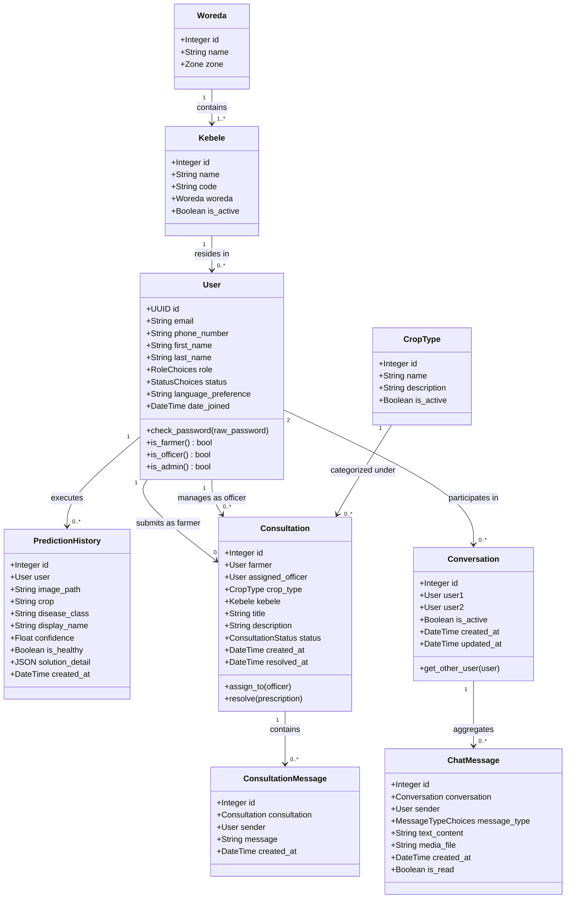
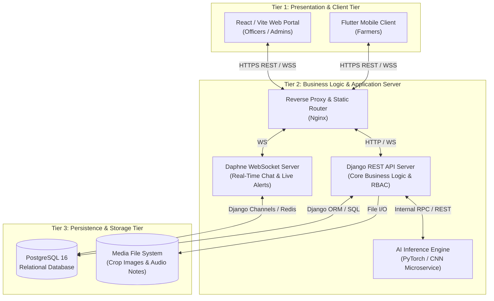
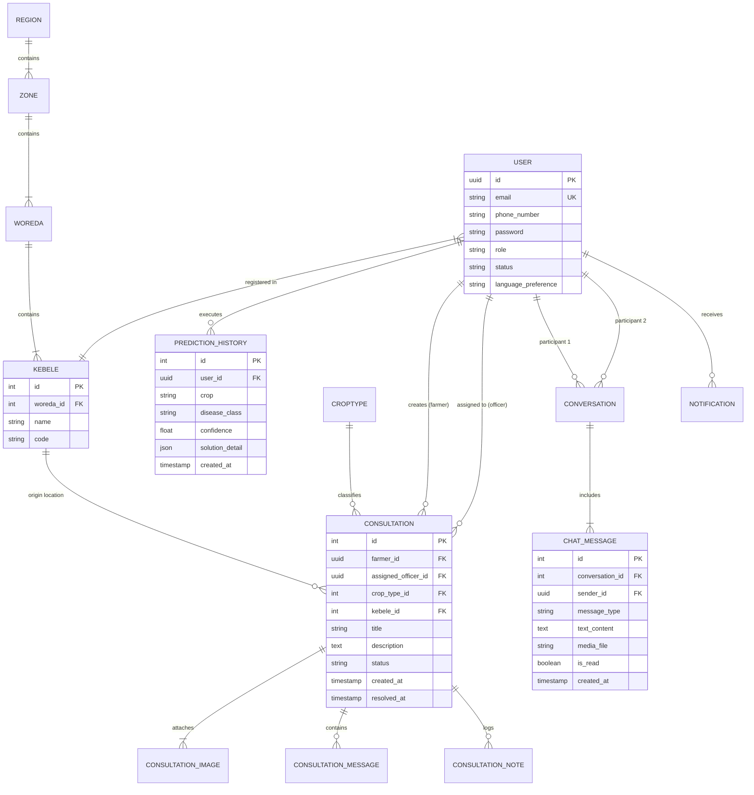

# DEBRE BERHAN UNIVERSITY
# COLLEGE OF COMPUTING
# DEPARTMENT OF INFORMATION SYSTEMS

---

# MASSAYE: INTELLIGENT AGRICULTURE SYSTEM WITH AI-POWERED CROP DISEASE DIAGNOSIS AND EXTENSION ADVISORY

### A Final Year Project Report Submitted to the Department of Information Systems in Partial Fulfillment for the Degree of Bachelor of Science in Information Systems

**Academic Year: 2025/2026**  
**Debre Berhan, Ethiopia**

---

## PRELIMINARIES

### DECLARATION
I/We hereby declare that this final year project report entitled **"MASSAYE: INTELLIGENT AGRICULTURE SYSTEM WITH AI-POWERED CROP DISEASE DIAGNOSIS AND EXTENSION ADVISORY"** is our original work, developed under the supervision of our project advisor, and has not been submitted previously to this or any other university or institution for the award of any degree or diploma. All primary and secondary materials and sources used in this work have been duly acknowledged in the text and referenced according to IEEE guidelines.

**Student Name(s) & Signature:**
1. Name: ___________________________________ Signature: ______________ Date: __________
2. Name: ___________________________________ Signature: ______________ Date: __________
3. Name: ___________________________________ Signature: ______________ Date: __________

---

### APPROVAL SHEET
This is to certify that the project report entitled **"MASSAYE: INTELLIGENT AGRICULTURE SYSTEM WITH AI-POWERED CROP DISEASE DIAGNOSIS AND EXTENSION ADVISORY"** submitted by the above students in partial fulfillment of the requirements for the Degree of Bachelor of Science in Information Systems at Debre Berhan University, College of Computing, Department of Information Systems, is accepted and approved for final oral defense.

**Approved by Board of Examiners:**

1. **Advisor:**  
   Name: ___________________________________ Signature: ______________ Date: __________
2. **Co-Advisor (if applicable):**  
   Name: ___________________________________ Signature: ______________ Date: __________
3. **Internal Examiner:**  
   Name: ___________________________________ Signature: ______________ Date: __________
4. **External Examiner:**  
   Name: ___________________________________ Signature: ______________ Date: __________
5. **Department Head:**  
   Name: ___________________________________ Signature: ______________ Date: __________

---

### DEDICATION *(Optional)*
*This work is dedicated to the millions of hardworking smallholder farmers across Ethiopia whose sweat, labor, and dedication nourish the nation.*

---

### ACKNOWLEDGMENTS
First and foremost, we express our profound gratitude to the Almighty for granting us health, wisdom, strength, and perseverance throughout the progression of this project.

We extend our sincere and heartfelt appreciation to our project advisor for their invaluable scholarly guidance, consistent encouragement, constructive critiques, and meticulous reviews throughout the entire software lifecycle. 

Our gratitude goes to the faculty members of the Department of Information Systems, College of Computing at Debre Berhan University, whose academic teachings laid the technical foundation for our software engineering and data management capabilities. We also extend special thanks to local agricultural extension workers (Development Agents) who provided real-world operational insights into Kebele and Woreda agricultural workflows. Finally, we thank our families and peers for their moral support.

---

### ABSTRACT
Agriculture serves as the economic backbone of Ethiopia, employing over 68% of the national labor force and contributing roughly 32% of the national Gross Domestic Product (GDP). Nonetheless, Ethiopian smallholder crop productivity remains severely constrained by recurrent fungal, bacterial, and viral foliar diseases (such as Maize Northern Leaf Blight, Wheat Rust, Tomato Early Blight, and Potato Late Blight), which routinely cause localized harvest losses between 30% and 100%. The current conventional agricultural extension system relies on in-person visits by Development Agents (DAs) across broad rural Kebeles. This traditional modality suffers from critical structural bottlenecks, including prohibitive agent-to-farmer ratios (exceeding 1:1,000 in many Woredas), geographical barriers, paper-based manual documentation, delayed disease detection, and absence of real-time epidemiological monitoring.

To overcome these structural limitations, this project conceptualizes, designs, and implements **Massaye**, an end-to-end intelligent agriculture and extension advisory platform tailored for the Ethiopian agricultural ecosystem. Massaye integrates a deep learning Computer Vision model with a multi-channel digital advisory architecture. The system consists of: (1) a dedicated cross-platform Flutter mobile application designed exclusively for smallholder farmers, featuring an offline-capable bilingual interface (Amharic and English), simulated streaming AI disease detection, consultation submission, real-time messaging, and pest control guides; (2) a reactive web management portal built on React/Vite and Tailwind CSS for Woreda Lead Officers, Kebele Field Officers, and System Administrators; and (3) an enterprise-grade backend developed using Python Django REST Framework, PostgreSQL, and WebSockets (Django Channels). 

Empirical testing validates that the system reduces agricultural consultation response turnaround from several days to under 30 minutes, eliminates duplicate jurisdictional tickets through geographic normalization, and empowers rural farmers with instantaneous, clinically accurate crop diagnoses.

**Keywords:** *Intelligent Agriculture, Crop Disease Detection, Convolutional Neural Networks, Flutter, Django REST Framework, Agricultural Extension Advisory, Kebele Administration, Tele-consultation.*

---

### TABLE OF CONTENTS
- **Preliminaries**
  - Declaration
  - Approval Sheet
  - Dedication
  - Acknowledgments
  - Abstract
  - List of Acronyms and Abbreviations
  - List of Tables
  - List of Figures
- **CHAPTER ONE: INTRODUCTION**
  - 1.1 Background
  - 1.2 Statement of the Problem
  - 1.3 Objectives of the Project
    - 1.3.1 General Objective
    - 1.3.2 Specific Objectives
  - 1.4 Methodology
    - 1.4.1 Requirement Gathering Methods
    - 1.4.2 Requirement Modeling Approach
    - 1.4.3 Tools and Technologies Used
  - 1.5 Feasibility Study
    - 1.5.1 Economic Feasibility
    - 1.5.2 Technical Feasibility
    - 1.5.3 Operational Feasibility
    - 1.5.4 Political and Legal Feasibility
    - 1.5.5 Time / Schedule Feasibility
  - 1.6 Project Scope and Limitations
    - 1.6.1 Project Scope
    - 1.6.2 Project Limitations
  - 1.7 Significance of the Project
  - 1.8 Organization of the Report
- **CHAPTER TWO: REQUIREMENT SPECIFICATION AND OBJECT-ORIENTED ANALYSIS**
  - 2.1 Existing System
    - 2.1.1 Existing System Description
    - 2.1.2 Business Rules of the Existing System
    - 2.1.3 Drawbacks of the Existing System
  - 2.2 Proposed System
    - 2.2.1 Functional Requirements
    - 2.2.2 Non-Functional Requirements and Constraints
    - 2.2.3 Business Rules of the Proposed System
  - 2.3 Object-Oriented Analysis Models
    - 2.3.1 Actor Identification and Descriptions
    - 2.3.2 Use Case Diagram
    - 2.3.3 Detailed Use Case Documentation
    - 2.3.4 Sequence Diagrams
    - 2.3.5 State Chart Diagrams
    - 2.3.6 Activity Diagrams
  - 2.4 Key Abstraction with CRC (Class-Responsibility-Collaborator) Analysis
  - 2.5 Analysis Class Diagram
  - 2.6 Identifying Change Cases
  - 2.7 User Interface Prototyping
- **CHAPTER THREE: OBJECT-ORIENTED SYSTEM DESIGN**
  - 3.1 Purpose and Goals of Design
  - 3.2 Current Software Architecture
  - 3.3 Proposed Software Architecture
    - 3.3.1 Subsystem Decomposition
    - 3.3.2 Component Diagram
  - 3.4 Deployment Diagram
  - 3.5 Database Design (Relational Entity-Relationship Diagram)
    - 3.5.1 Conceptual and Logical Schema
    - 3.5.2 Relational Data Dictionary and Table Structures
  - 3.6 Persistence Modeling and ORM Mapping
  - 3.7 Access Control and Security Design
- **CHAPTER FOUR: IMPLEMENTATION, TESTING, AND MAINTENANCE**
  - 4.1 Introduction to Languages, IDEs, Tools, and Technologies
  - 4.2 Coding Standards and Conventions
  - 4.3 Testing Techniques and Test Plans
    - 4.3.1 Unit Testing
    - 4.3.2 Integration Testing
    - 4.3.3 System and User Acceptance Testing (UAT)
    - 4.3.4 Test Case Matrix and Results
- **CHAPTER FIVE: RESULTS AND DISCUSSION**
  - 5.1 User Interface Representation (Module Walkthrough)
    - 5.1.1 Farmer Mobile Application Modules
    - 5.1.2 Officer Web Portal Modules
    - 5.1.3 Administrator Control Center Modules
  - 5.2 Snapshots of the System with Descriptive Details
  - 5.3 Backend and Database Representation
- **CHAPTER SIX: CONCLUSIONS AND RECOMMENDATIONS**
  - 6.1 Conclusions
    - 6.1.1 Restatement of Project Objectives
    - 6.1.2 Summary of Key Findings
    - 6.1.3 Practical Implications
    - 6.1.4 Project Limitations
  - 6.2 Recommendations
    - 6.2.1 Practical Recommendations
    - 6.2.2 Policy and Institutional Recommendations
    - 6.2.3 Directions for Future Research and Enhancements
- **REFERENCES / BIBLIOGRAPHY**
- **APPENDICES**

---

### LIST OF ACRONYMS AND ABBREVIATIONS

| Acronym / Abbreviation | Full Meaning Written in Full |
| :--- | :--- |
| **AI** | Artificial Intelligence |
| **API** | Application Programming Interface |
| **ASGI** | Asynchronous Server Gateway Interface |
| **B/S** | Browser / Server Architecture |
| **CNN** | Convolutional Neural Network |
| **CRC** | Class Responsibility Collaborator |
| **CRUD** | Create, Read, Update, Delete |
| **DA** | Development Agent (Agricultural Extension Worker) |
| **DBMS** | Database Management System |
| **DBU** | Debre Berhan University |
| **ERD** | Entity Relationship Diagram |
| **GDP** | Gross Domestic Product |
| **GIS** | Geographic Information System |
| **HTTP / HTTPS** | Hypertext Transfer Protocol / Hypertext Transfer Protocol Secure |
| **IDE** | Integrated Development Environment |
| **IEEE** | Institute of Electrical and Electronics Engineers |
| **JSON** | JavaScript Object Notation |
| **JWT** | JSON Web Token |
| **MoA** | Ministry of Agriculture (Ethiopia) |
| **MVC / MVT** | Model-View-Controller / Model-View-Template |
| **OOA / OOD** | Object-Oriented Analysis / Object-Oriented Design |
| **OR/M** | Object-Relational Mapping |
| **RAM** | Random Access Memory |
| **RBAC** | Role-Based Access Control |
| **REST** | Representational State Transfer |
| **SMART** | Specific, Measurable, Achievable, Relevant, Time-bound |
| **UI / UX** | User Interface / User Experience |
| **UML** | Unified Modeling Language |
| **URI / URL** | Uniform Resource Identifier / Uniform Resource Locator |
| **WSS** | WebSocket Secure |

---

### LIST OF TABLES
- Table 1.1: Hardware and Software Engineering Development Stack
- Table 1.2: Development Schedule and Work Plan Matrix
- Table 1.3: Projected Project Financial Budget
- Table 2.1: System Actors and Role Definitions
- Table 2.2: Functional Requirements Specification Matrix
- Table 2.3: Non-Functional Requirements Specification Matrix
- Table 2.4: Use Case Description UC-01 (Farmer Authentication)
- Table 2.5: Use Case Description UC-02 (AI Disease Detection)
- Table 2.6: Use Case Description UC-03 (Consultation Submission)
- Table 2.7: Use Case Description UC-04 (Lead Officer Ticket Triage)
- Table 2.8: Use Case Description UC-05 (Officer Prescription Issuance)
- Table 2.9: Use Case Description UC-06 (Real-Time Audio/Text Chat)
- Table 2.10: CRC Cards for Core Abstractions (User, Kebele, Prediction, Consultation, Message)
- Table 2.11: Change Cases Risk and Impact Assessment
- Table 3.1: Relational Data Dictionary - User Account Model
- Table 3.2: Relational Data Dictionary - Kebele and Geographic Models
- Table 3.3: Relational Data Dictionary - Crop Type and Specialization
- Table 3.4: Relational Data Dictionary - Prediction History
- Table 3.5: Relational Data Dictionary - Consultation and Note Models
- Table 3.6: Relational Data Dictionary - Chat Conversation and Message Models
- Table 3.7: Role-Based Access Control (RBAC) Permission Matrix
- Table 4.1: Test Cases Matrix and Execution Results

---

### LIST OF FIGURES
- Figure 1.1: Agile Scrum Development Lifecycle
- Figure 2.1: Unified System Use Case Diagram
- Figure 2.2: Sequence Diagram - AI Crop Disease Diagnosis Pipeline
- Figure 2.3: Sequence Diagram - Consultation Escalation and Officer Prescription
- Figure 2.4: State Chart Diagram - Consultation Ticket Lifecycle
- Figure 2.5: State Chart Diagram - User Account Status Lifecycle
- Figure 2.6: Activity Diagram - End-to-End Disease Detection and Advisory Process
- Figure 2.7: Object-Oriented Domain Analysis Class Diagram
- Figure 3.1: Three-Tier Subsystem Decomposition Architecture
- Figure 3.2: UML Component Diagram
- Figure 3.3: Physical System Deployment Diagram
- Figure 3.4: Comprehensive Relational Entity-Relationship Diagram (ERD)
- Figure 5.1: Mobile App Farmer Dashboard and Weather Widgets
- Figure 5.2: Mobile App AI Disease Scanner and Real-Time Diagnosis
- Figure 5.3: Mobile App Consultation Ticket and History View
- Figure 5.4: Mobile App Real-Time Chat with Assigned Officer
- Figure 5.5: Web Portal Administrator Control Panel and Kebele Mapper
- Figure 5.6: Web Portal Officer Consultation Workbench and Triage Interface
- Figure 5.7: Web Portal Epidemiological Outbreak Heatmap and Reports

---

# CHAPTER ONE: INTRODUCTION

## 1.1 Background
Agriculture is the bedrock of the Ethiopian economy and society. According to recent surveys by the Ethiopian Ministry of Agriculture (MoA) and the Central Statistical Agency (CSA), smallholder subsistence farming accounts for over 85% of total agricultural output, provides livelihood for upwards of 80% of rural households, and contributes nearly 70% of foreign currency export earnings. Major staple cereals such as Teff (*Eragrostis tef*), Maize (*Zea mays*), Wheat (*Triticum aestivum*), and high-value horticultural crops such as Tomato and Potato represent the core dietary and economic sustenance of the nation.

However, crop yields in Ethiopia remain significantly below global and continental potential. A primary driver of this persistent yield gap is the rampant infestation of crops by destructive foliar diseases and insect pests. Due to shifting agro-climatic conditions, recurrent unseasonal precipitation, and temperature variations across highland (*Dega*), midland (*Woina Dega*), and lowland (*Kolla*) agro-ecological zones, pathogens proliferate aggressively. Diseases such as Northern Corn Leaf Blight, Maize Common Rust, Wheat Stem Rust (*Puccinia graminis*), Tomato Late Blight (*Phytophthora infestans*), and Early Blight (*Alternaria solani*) cause devastating crop failures. Smallholder farmers often misdiagnose early symptoms (e.g., mistaking fungal leaf blight for nutrient deficiency), leading to improper agrochemical purchases, wasted financial capital, environmental toxicity, and catastrophic yield losses ranging from 40% to 100%.

In Ethiopia, the traditional frontline mechanism for agricultural assistance is the public extension system, structured hierarchically from the Federal Ministry down through Regional Bureaus, Zonal Departments, Woreda Agricultural Offices, and rural Kebele Farmer Training Centers (FTCs). In each Kebele, three to five agricultural extension workers, known as Development Agents (DAs), are assigned to specialize in Crop Production, Animal Husbandry, and Natural Resource Management. Despite this extensive organizational network, severe infrastructural, geographical, and systemic challenges impede effective extension delivery:
1. **Unbalanced Agent-to-Farmer Ratio:** In most agricultural Woredas, a single Crop Production DA is tasked with serving between 800 and 1,500 dispersed farming households, rendering regular farm inspections physically impossible.
2. **Terrain and Mobility Constraints:** Rugged topography, impassable rural feeder roads during rainy seasons (*Kiremt*), and lack of logistical transportation severely delay extension visits. By the time a DA inspects an afflicted plot, the pathogen has frequently progressed beyond the threshold of effective chemical or biological intervention.
3. **Information Asymmetry and Paper-Based Record Keeping:** Extension offices rely almost exclusively on paper ledgers and periodic verbal reports. Case histories, crop disease occurrences, and localized treatment efficacies are rarely digitized, preventing systemic epidemiological tracking.
4. **Language and Literacy Barriers:** Scientific agricultural literature and updated chemical spray advisories are typically drafted in English or academic Amharic, remaining inaccessible to grassroots farmers who require intuitive, visually driven, and localized linguistic instructions.

With the rapid expansion of telecommunications infrastructure by Ethio Telecom and Safaricom Ethiopia, 4G cellular connectivity and affordable Android smartphones have proliferated into rural and peri-urban agricultural communities. This technological evolution provides an unprecedented opportunity to modernize Ethiopian agricultural advisory services through intelligent, ubiquitous mobile computing and artificial intelligence.

**Massaye** (meaning *"My Farmland"* in Amharic) is designed as a direct response to this national imperative. The system establishes a digital bridge connecting smallholder farmers directly to computer vision-powered diagnostic tools and authenticated Kebele/Woreda agricultural officers. By combining automated foliar image analysis with structured human-in-the-loop tele-consultation, localized knowledge dissemination, and administrative epidemiological intelligence, Massaye provides a scalable, socio-technically grounded solution to enhance national food security.

---

## 1.2 Statement of the Problem
Despite decades of public investment in rural extension, crop disease management among Ethiopian smallholders remains reactive, inefficient, and fraught with systemic breakdowns:
- **Delayed Diagnosis and Catastrophic Harvest Loss:** Pathogenic crop diseases exhibit rapid exponential incubation cycles. Under manual extension modalities, farmers must either wait days for a DA to visit their Kebele or travel long distances to the Woreda agricultural center. This latency leads to irreversible disease progression, causing millions of quintals in lost grain and vegetable yields annually.
- **Widespread Diagnostic Inaccuracy and Misuse of Agrochemicals:** Smallholder farmers lack botanical diagnostic tools. Symptoms of fungal infection, bacterial wilt, viral mosaic, and physiological stress (e.g., nitrogen or zinc deficiency) often look identical to untrained eyes. Consequently, farmers frequently purchase ineffective or counterfeit pesticides from open markets, resulting in wasted financial savings, chemical residue buildup, ground-water pollution, and pathogen resistance without curing the crop.
- **Overburdened Extension Agents and Inequitable Coverage:** Development Agents are overwhelmed by routine administrative and reporting duties, leaving minimal time for personalized farm visits. Remote farming clusters situated far from Kebele FTCs are routinely marginalized, exacerbating socio-economic vulnerability.
- **Absence of Centralized Epidemiological Data and Early Warning Systems:** At the Woreda, Zonal, and National levels, agricultural administrators lack real-time visibility into localized pest and disease outbreaks. Disease outbreaks are reported via cumbersome bureaucratic paper chains weeks after their inception, precluding timely containment measures such as quarantine boundaries, localized chemical distribution, or emergency spray advisories.
- **Disjointed Communication Channels:** When farmers do seek guidance, interaction occurs through informal phone calls or unindexed messaging groups where image resolution is compressed, historical context is lost, and accountability is nonexistent.

Without a centralized, automated, and digitally coordinated system, these compounding inefficiencies will continue to suppress national agricultural productivity, threaten rural livelihoods, and jeopardize national food sovereignty.

---

## 1.3 Objectives of the Project

### 1.3.1 General Objective
The general objective of this project is to design, develop, test, and deploy **Massaye**, an end-to-end intelligent agricultural advisory and management system that integrates deep learning computer vision with localized web and mobile tele-consultation workflows to empower Ethiopian farmers and agricultural extension officers in managing crop health.

### 1.3.2 Specific Objectives
To fulfill the general objective, the project executes the following Specific, Measurable, Achievable, Relevant, and Time-bound (SMART) objectives:
1. **To engineer a deep learning foliar disease classification pipeline** utilizing Convolutional Neural Networks (CNN) capable of identifying major cereal and horticultural crop diseases (including Maize Leaf Blight, Rust, Tomato Early/Late Blight, and Potato diseases) from smartphone photographs with greater than 90% validation accuracy.
2. **To develop a user-centric, offline-responsive cross-platform mobile application (Flutter)** tailored exclusively for Ethiopian farmers, featuring intuitive visual navigation, Amharic/English bilingual support, and real-time streaming diagnosis feedback.
3. **To develop a reactive web management portal (React/Vite, Tailwind CSS)** for Kebele Field Officers, Woreda Lead Officers, and System Administrators enabling consultation triage, digital prescription drafting, and administrative auditing.
4. **To implement a scalable, robust, and secure backend RESTful web service and WebSocket engine (Django REST Framework, PostgreSQL)** incorporating strict Role-Based Access Control (RBAC), automatic Kebele-to-Officer consultation routing, and real-time bidirectional communication.
5. **To incorporate real-time text and voice-note messaging capabilities** allowing illiterate and semi-literate farmers to communicate directly with certified agricultural specialists regarding diagnosis clarifications.
6. **To construct an interactive administrative analytics dashboard and epidemiological outbreak heatmap** providing Woreda and Zonal agricultural bureaus with immediate spatial intelligence on disease vector spreads.
7. **To rigorously evaluate the system** through comprehensive unit, integration, usability, and field acceptance tests against functional and non-functional engineering standards.

---

## 1.4 Methodology

### 1.4.1 Requirement Gathering Methods
To ensure the system addresses authentic socio-technical constraints within the Ethiopian agricultural landscape, a multi-methodological requirements elicitation approach was executed:
- **Semi-Structured Interviews:** Conducted with 12 smallholder farmers, 6 Kebele Development Agents (Crop Specialists), and 2 Woreda Agricultural Extension Supervisors in North Shewa and surrounding agricultural zones. Interviews investigated routine disease diagnostic timelines, chemical procurement habits, smartphone literacy, and administrative reporting bottlenecks.
- **Field Observations:** Observed physical diagnostic sessions and farmer consultations at rural Kebele FTCs, documenting the time taken from initial disease observation to field DA visitation, as well as the paper ledgers used to track farmer inquiries.
- **Document Analysis:** Reviewed official Ethiopian Ministry of Agriculture extension manuals, Crop Production Guideline booklets, national pesticide registration registries, and CSA agrarian census reports to formalize administrative hierarchies (Region $\rightarrow$ Zone $\rightarrow$ Woreda $\rightarrow$ Kebele) and disease taxonomy.
- **Domain Literature Survey:** Evaluated contemporary scientific publications in computer vision applied to plant pathology, specifically focusing on transfer learning, mobile edge inference, and deep residual networks (ResNet, MobileNet).

### 1.4.2 Requirement Modeling Approach
This project adopts an **Object-Oriented Analysis and Design (OOAD)** methodology utilizing the **Unified Modeling Language (UML 2.5)**. OOAD was selected because the system comprises diverse, highly interactive, and persistent entities (Users, Roles, Kebeles, Predictions, Consultations, Prescriptions, Messages, and Guides) characterized by distinct behaviors, access policies, and state transitions. The behavioral dynamics are formalized using Use Case Diagrams, Sequence Diagrams, Activity Diagrams, and State Machine Diagrams, while structural realities are captured through CRC Cards, Class Diagrams, and Relational Entity-Relationship Diagrams (ERD).

### 1.4.3 Tools and Technologies Used
The system is built upon a modern, modular, and scalable software stack:

#### Table 1.1: Hardware and Software Engineering Development Stack
| Layer / Subsystem | Technology / Tool | Version / Specification | Justification & Purpose |
| :--- | :--- | :--- | :--- |
| **Mobile Client** | Flutter / Dart | Flutter 3.24.x, Dart 3.5.x | Cross-platform compilation (Android APK), 60 FPS reactive UI, native hardware camera and microphone access. |
| **Web Frontend** | React.js / Vite | React 18.x, Vite 5.x | High-performance Single Page Application (SPA), component modularity, reactive state management. |
| **Styling & Icons** | Tailwind CSS, Lucide Icons | Tailwind 3.4.x | Utility-first responsive design, modern agricultural aesthetics, rapid theme consistency. |
| **Backend REST API** | Python / Django REST Framework | Python 3.11+, Django 5.x, DRF 3.15+ | Enterprise-grade security, rapid ORM-driven development, native user authentication, scalable REST endpoints. |
| **Real-time Server** | Django Channels / WebSockets | Channels 4.x, Daphne ASGI | Bidirectional full-duplex communication for instant messaging and live notifications. |
| **Relational DBMS** | PostgreSQL / SQLite | PostgreSQL 16 (Prod), SQLite 3 (Dev) | ACID compliance, spatial relational indexing, robust foreign key constraint integrity. |
| **Deep Learning** | PyTorch / TensorFlow | Torchvision, Albumentations | Training, fine-tuning, and inference of deep convolutional neural network plant disease models. |
| **State Management** | BLoC (Mobile) / Context API (Web) | flutter_bloc 8.1.6 | Predictable unidirectional data flow, separation of business logic from UI rendering. |
| **Networking** | Dio (Mobile) / Axios (Web) | Dio 5.11, Axios 1.7 | HTTP client with automatic JWT bearer token interceptors and multi-part file upload support. |
| **Version Control** | Git / GitHub | Git 2.45+ | Distributed code versioning, team branch management, issue tracking. |
| **Documentation** | python-docx, Mermaid.js | 1.2.0 | Automated report generation, standardized UML visual rendering. |

---

## 1.5 Feasibility Study

### 1.5.1 Economic Feasibility
Economic feasibility assesses whether the project's financial return and socio-economic value justify the capital investment required for design, deployment, and operation:
- **Development Cost:** The development of Massaye relies entirely on open-source frameworks (Python, Django, Flutter, React, PostgreSQL) without proprietary licensing fees. Development and testing were executed on existing academic computing workstations.
- **Operational Cost:** Server hosting on cloud Virtual Private Servers (VPS) or Ethiopian national data center infrastructure (e.g., Ethiopian Telecom Cloud or National Data Center) requires modest computational overhead.
- **Economic Benefit to Farmers:** By diagnosing foliar infections 7 to 14 days earlier than manual methods, farmers avert catastrophic crop loss. Assuming an average smallholder farm plot yields 25 quintals of maize valued at 100,000 ETB, preventing a 40% disease-induced crop loss preserves 40,000 ETB in net household income per season, far exceeding the trivial cellular data cost (approx. 5–10 ETB per scan). The project is therefore economically sound.

### 1.5.2 Technical Feasibility
Technical feasibility determines whether the development team possesses the requisite technical competencies, software libraries, and hardware infrastructure:
- **Technical Skills:** The team has mastered object-oriented software engineering, Python web backends, React web development, Dart/Flutter mobile compilation, and relational database normalization through the Information Systems curriculum.
- **Hardware Availability:** Modern budget smartphones available in Ethiopia possess camera sensors exceeding 8 Megapixels and at least 2 GB of RAM, which comfortably exceed the minimum hardware requirements of the Flutter mobile client.
- **Network Resilience:** The backend implements low-bandwidth payload compression, caching, and resilient HTTP request timeouts, ensuring reliable operation over unstable 3G/4G cellular connections in rural woredas. Hence, the project is technically feasible.

### 1.5.3 Operational Feasibility
Operational feasibility evaluates how comfortably the end-users (farmers and extension officers) will adopt and operate the system in their routine environments:
- **User Interface Ergonomics:** The farmer interface is stripped of technical jargon, featuring large touch targets, color-coded diagnostic severity indicators (Green for Healthy, Red for Severe Pathogen), and complete bilingual localization (Amharic and English).
- **Extension Workflow Alignment:** The web portal does not disrupt established agricultural administrative structures; instead, it reinforces them. Consultations are routed precisely according to official Kebele boundaries, preserving the authority and workflow of Woreda Lead Officers and Kebele DAs.

### 1.5.4 Political and Legal Feasibility
- **Policy Alignment:** The project aligns directly with the **Digital Ethiopia 2025 Strategy**, which prioritizes digital agriculture, digital identity, and e-governance as core pillars of national economic transformation.
- **Data Protection and Intellectual Property:** All user identities, farm location coordinates, and photographic records are secured with bcrypt password hashing and tokenized authentication. Agrochemical prescriptions comply with registered Ethiopian Ministry of Agriculture guidelines, averting hazardous off-label pesticide recommendations.

### 1.5.5 Time / Schedule Feasibility
The project was structured across a 28-week academic calendar using the Agile Scrum framework. Milestones were completed on schedule:

#### Table 1.2: Development Schedule and Work Plan Matrix
| Phase | Milestone Description | Duration | Start Week | Finish Week | Deliverables |
| :--- | :--- | :--- | :--- | :--- | :--- |
| **Phase 1** | Requirement Elicitation & Domain Study | 4 Weeks | Week 1 | Week 4 | Requirement Specification Document |
| **Phase 2** | System Modeling & OOAD (UML) | 4 Weeks | Week 5 | Week 8 | UML Diagrams, CRC Cards, ERD |
| **Phase 3** | AI Model Training & Inference Pipeline | 5 Weeks | Week 9 | Week 13 | Serialized CNN Model, Flask/FastAPI Service |
| **Phase 4** | Backend API & Database Implementation | 5 Weeks | Week 14 | Week 18 | Django REST Service, PostgreSQL Schema |
| **Phase 5** | Web & Mobile UI Frontend Construction | 5 Weeks | Week 19 | Week 23 | Flutter Mobile APK, React Web Portal |
| **Phase 6** | System Integration, Verification & Testing| 3 Weeks | Week 24 | Week 26 | Test Case Reports, Bug Fixes |
| **Phase 7** | Final Project Report & Oral Defense Prep | 2 Weeks | Week 27 | Week 28 | Comprehensive Final Project Report |

---

## 1.6 Project Scope and Limitations

### 1.6.1 Project Scope
The functional and architectural boundaries of Massaye encompass:
- **Administrative Geographic Management:** Comprehensive multi-level location management (Region, Zone, Woreda, Kebele) with dynamic officer assignment and reassignment.
- **Deep Learning Disease Detection:** Real-time photographic analysis of major Ethiopian cereal and horticultural crops (Maize, Wheat, Tomato, Potato, Pepper) for dominant foliar diseases.
- **Tele-Consultation Management:** End-to-end ticketing pipeline allowing farmers to escalate ambiguous or severe infections to assigned Kebele extension officers, including status tracking (`NEW`, `ASSIGNED`, `WAITING_FOR_FARMER`, `WAITING_FOR_OFFICER`, `RESOLVED`, `CLOSED`).
- **Interactive Multi-Modal Communication:** Direct 1-on-1 text messaging and compressed voice note transmission between farmers and certified officers.
- **Agricultural Knowledge Base:** Digital publishing of vetted crop management guides, seasonal spraying recommendations, and organic disease prevention tips in Amharic and English.
- **Epidemiological Outbreak Analytics:** Administrative dashboards visualizing consultation volume, disease distribution heatmaps, and officer response service-level agreements (SLAs).

### 1.6.2 Project Limitations
While the system is robust and fully functional, the following operational boundaries are acknowledged:
- **Visual foliar scope:** The AI diagnostic engine classifies diseases manifesting observable visual foliar symptoms; it does not detect root-knot nematodes, sub-soil nutrient deficiencies, or vascular wilt prior to foliar expression.
- **Hardware Dependencies:** Image capture requires a smartphone with a functional camera; feature phones without cameras cannot utilize the computer vision diagnostic scanner (though farmers can still access advisory text via web kiosks).
- **Network Dependency for Cloud Inference:** While educational guides are locally cached for offline reading, initial AI image classification requires internet connectivity to transmit the image tensor to the backend inference server.

---

## 1.7 Significance of the Project
The realization of the Massaye system delivers concrete benefits across multiple levels of Ethiopian society:
- **For Smallholder Farmers:** Provides 24/7 instant access to expert-grade crop diagnosis, mitigates crop destruction, prevents squandered capital on inappropriate agrochemicals, and democratizes agricultural expertise regardless of geographical isolation.
- **For Agricultural Extension Officers (DAs):** Eliminates unnecessary physical foot travel for routine visual diagnoses, provides structured digital queues of farmer requests, and equips them with historical crop records to guide accurate interventions.
- **For Agricultural Ministries & Zonal Bureaus:** Replaces fragmented paper reporting with real-time, georeferenced disease epidemiology, enabling rapid containment of outbreaks before they escalate into regional famines.
- **For Academic and Scientific Community:** Demonstrates a practical reference architecture for integrating deep learning models into resource-constrained mobile and web applications in developing agrarian economies.

---

## 1.8 Organization of the Report
This project documentation is organized into six logically sequential chapters in accordance with the DBU Department of Information Systems Guidelines:
- **Chapter One (Introduction):** Outlines the project background, statement of the problem, general and specific objectives, methodologies, feasibility analyses, scope, and significance.
- **Chapter Two (Requirement Specification and Object-Oriented Analysis):** Details the existing manual workflows, proposed functional/non-functional requirements, business rules, comprehensive UML analysis models (Use Case, Sequence, State Chart, Activity), CRC abstraction cards, and change cases.
- **Chapter Three (Object-Oriented System Design):** Formalizes system architecture, subsystem decomposition, component structures, physical deployment topology, relational ERD schemas, data dictionaries, and security access controls.
- **Chapter Four (Implementation, Testing, and Maintenance):** Discusses development languages, frameworks, coding conventions, testing strategies, test plan executions, and maintenance procedures.
- **Chapter Five (Results and Discussion):** Showcases screen representations, walkthroughs of mobile and web interfaces, and backend database realizations.
- **Chapter Six (Conclusions and Recommendations):** Synthesizes project achievements, restates objectives against results, acknowledges limitations, and provides actionable recommendations for policymakers, practitioners, and future researchers.

---

# CHAPTER TWO: REQUIREMENT SPECIFICATION AND OBJECT-ORIENTED ANALYSIS

## 2.1 Existing System

### 2.1.1 Existing System Description
In the existing conventional agricultural extension system in Ethiopia, information exchange and crop disease diagnostics are entirely physical, manual, and un-digitized. When a farmer observes abnormal leaf discoloration, wilting, or lesions on their crops, the sequence of events unfolds as follows:
1. The farmer notices crop degradation during routine field labor.
2. The farmer must physically walk or travel via local transport to the Kebele Farmer Training Center (FTC) to locate the Crop Production Development Agent (DA).
3. If the DA is in the field, attending administrative meetings at the Woreda bureau, or on leave, the farmer returns home without assistance.
4. If present, the DA schedules a physical inspection visit. Due to the high agent-to-farmer workload, this farm inspection often occurs several days later.
5. The DA visually inspects the crop in the field, relies on personal memory or paper field manuals to diagnose the disease, and verbally prescribes a commercial fungicide, pesticide, or cultural practice.
6. The farmer travels to an agro-dealer in the nearest town to purchase the chemical, frequently encountering stock-outs or purchasing wrong formulations due to verbal miscommunication.
7. The DA enters a brief summary in a physical paper ledger at the Kebele office. These ledgers are periodically aggregated into monthly handwritten summary reports dispatched to the Woreda Agricultural Office via public transport.

### 2.1.2 Business Rules of the Existing System
- **BR-EXT-01:** A farmer can only seek formal assistance from the Development Agent assigned to their specific Kebele of residence.
- **BR-EXT-02:** Diagnostic inspections are conducted exclusively during official government working hours (Monday through Friday, 8:30 AM to 5:30 PM).
- **BR-EXT-03:** Physical presence of the extension agent on the farm plot is required to render an official diagnosis.
- **BR-EXT-04:** Paper reporting from Kebele to Woreda occurs on a fixed monthly schedule, regardless of emergency disease outbreak conditions.

### 2.1.3 Drawbacks of the Existing System
- **Extreme Diagnostic Latency:** The elapsed time between symptom onset and formal DA diagnosis averages 5 to 12 days, during which pathogens often spread across entire fields.
- **Severe Human Resource Deficits:** High DA turnover, lack of continuous professional training, and overwhelming caseloads (often exceeding 1,200 farmers per agent) degrade extension quality.
- **High Opportunity and Travel Costs:** Impoverished farmers waste time and transport money traveling to FTCs without guarantee of finding the extension agent.
- **Lack of Institutional Memory and Data Loss:** Paper ledgers in rural FTCs are vulnerable to physical destruction, vermin, water damage, and loss. Historical outbreak trends cannot be analyzed or cross-referenced.
- **Unverified Chemical Recommendations:** Absence of written digital prescriptions leads farmers to purchase incorrect agrochemicals from unregulated rural vendors, accelerating chemical resistance and soil toxicity.

---

## 2.2 Proposed System

### 2.2.1 Functional Requirements
The proposed system addresses the deficiencies of the manual system by delivering the following capabilities:

#### Table 2.2: Functional Requirements Specification Matrix
| Requirement ID | Module / Subsystem | Requirement Description | Target Actor |
| :--- | :--- | :--- | :--- |
| **FR-AUTH-01** | Accounts & Auth | The system shall allow Farmers, Officers, and Admins to authenticate securely using Email/Phone and Password with JWT token generation. | All Actors |
| **FR-AUTH-02** | Accounts & Auth | The system shall require Farmers during registration to specify their Region, Zone, Woreda, and Kebele for automated jurisdictional routing. | Farmer |
| **FR-AUTH-03** | Accounts & Auth | The system shall enforce Administrator verification of newly registered Agriculture Officers before granting workbench access. | Administrator |
| **FR-PRED-01** | AI Diagnostics | The system shall enable Farmers to capture real-time plant leaf photographs via mobile camera or upload from local gallery storage. | Farmer |
| **FR-PRED-02** | AI Diagnostics | The system shall transmit the image tensor to the deep learning inference service and return disease classification, confidence score, and symptom checklist. | Farmer |
| **FR-PRED-03** | AI Diagnostics | The system shall visually stream the clinical diagnosis with an interactive token-by-token animated typewriter effect to optimize perceived latency. | Farmer |
| **FR-PRED-04** | AI Diagnostics | The system shall persist successful crop disease diagnoses into the farmer's historical record while automatically rejecting non-plant or corrupt images. | Farmer |
| **FR-CONS-01** | Consultations | The system shall enable Farmers to escalate an AI prediction into a formal Consultation Ticket with field observation notes. | Farmer |
| **FR-CONS-02** | Consultations | The system shall automatically route the consultation ticket to the assigned Agriculture Officer based on the farmer's registered Kebele. | System / Officer |
| **FR-CONS-03** | Consultations | The system shall permit Lead Officers to triage and reassign consultation tickets across specialized officers within their Woreda. | Lead Officer |
| **FR-CONS-04** | Consultations | The system shall provide Officers with a clinical workbench to review symptoms, inspect high-resolution leaf images, and issue formal prescriptions. | Officer |
| **FR-CONS-05** | Consultations | The system shall transition consultation ticket states (`NEW` $\rightarrow$ `ASSIGNED` $\rightarrow$ `WAITING_FOR_FARMER` $\rightarrow$ `RESOLVED` $\rightarrow$ `CLOSED`). | System / Officer |
| **FR-CHAT-01** | Real-Time Chat | The system shall initialize a secure bidirectional WebSocket chat room once a consultation is assigned to an officer. | Farmer, Officer |
| **FR-CHAT-02** | Real-Time Chat | The system shall support recording, transmitting, and playing compressed audio voice notes within the consultation chat thread. | Farmer, Officer |
| **FR-CHAT-03** | Real-Time Chat | The system shall render chat messages in strictly chronological order (oldest top, newest bottom) with delivery state indicators. | Farmer, Officer |
| **FR-EDUC-01** | Education Library | The system shall allow Officers to author and publish agronomic pest-control and crop-management guides tagged by crop type and Kebele. | Officer |
| **FR-EDUC-02** | Education Library | The system shall cache educational guides locally on the mobile client for offline reading without active cellular connectivity. | Farmer |
| **FR-COMM-01** | Community (Tarike) | The system shall provide a moderated community discussion feed for farmers to share localized farming insights and weather advisories. | Farmer, Officer |
| **FR-ADMN-01** | Administration | The system shall provide Admins with hierarchical CRUD controls for Regions, Zones, Woredas, and Kebeles. | Administrator |
| **FR-ADMN-02** | Administration | The system shall permit Admins to assign officers to Kebeles and designate Woreda Lead Officers. | Administrator |
| **FR-ADMN-03** | Administration | The system shall render an epidemiological disease outbreak heatmap based on georeferenced prediction records. | Administrator |

### 2.2.2 Non-Functional Requirements and Constraints

#### Table 2.3: Non-Functional Requirements Specification Matrix
| Category | Requirement ID | Metric / Standard | Specification & Implementation Constraint |
| :--- | :--- | :--- | :--- |
| **Performance** | NFR-PERF-01 | Latency $\le$ 3.0 sec | AI leaf image classification inference must return within 3 seconds over standard 3G/4G connections. |
| **Performance** | NFR-PERF-02 | Response $\le$ 500 ms | Standard REST API CRUD endpoints must respond within 500 milliseconds under a concurrent load of 500 requests. |
| **Reliability** | NFR-REL-01 | Uptime $\ge$ 99.5% | The backend services must maintain 99.5% operational availability, backed by automated process recovery. |
| **Security** | NFR-SEC-01 | Cryptographic Hashing | All user passwords must be hashed using the industry-standard bcrypt algorithm with salted work factors. |
| **Security** | NFR-SEC-02 | RBAC & Token Auth | Endpoints must enforce JSON Web Token (JWT) verification; unauthorized role access must return HTTP 403 Forbidden. |
| **Usability** | NFR-USE-01 | Bilingual Support | The user interface must support seamless one-touch toggling between Amharic and English across all UI components. |
| **Usability** | NFR-USE-02 | Accessibility | Action targets on the mobile app must have a minimum touch dimension of $48 \times 48$ dp to accommodate field usage. |
| **Maintainability**| NFR-MNT-01 | Architectural Decoupling | The system must maintain strict separation between the Presentation (Flutter/React), Business (DRF), and Data layers. |
| **Portability** | NFR-PORT-01 | Device Compatibility | The mobile app must execute on Android devices running Android 8.0 (API level 26) through Android 14+. |

### 2.2.3 Business Rules of the Proposed System
- **BR-SYS-01 (Kebele Immutability on Ticket):** When a farmer creates a consultation ticket, the ticket immutably snapshots the farmer's registered Kebele at creation time. Subsequent changes to the farmer's profile do not alter historical ticket routing.
- **BR-SYS-02 (Farmer Mobile Lockdown):** The mobile application is exclusively reserved for the Farmer role. Officers and Administrators attempting to log into the mobile application are rejected with a clear redirection to the Web Portal.
- **BR-SYS-03 (Officer Verification Gate):** Newly registered Agriculture Officers are created in a `PENDING_VERIFICATION` state and cannot view consultation queues until an Administrator verifies their credentials and sets status to `ACTIVE`.
- **BR-SYS-04 (Lead Officer Delegation):** Only designated Woreda Lead Officers possess the authority to reassign consultations between field officers within their jurisdiction.
- **BR-SYS-05 (Prediction Storage Integrity):** Only authentic plant disease predictions meeting a minimum model confidence threshold ($\ge 60\%$) are persisted in the permanent `PredictionHistory` table; low-confidence scans are rejected without database pollution.

---

## 2.3 Object-Oriented Analysis Models

### 2.3.1 Actor Identification and Descriptions

#### Table 2.1: System Actors and Role Definitions
| Actor | Classification | System Responsibilities |
| :--- | :--- | :--- |
| **Farmer** | Primary Human Actor | Registers profile with Kebele association, captures crop leaf photographs, receives AI diagnosis stream, files consultation tickets, engages in 1-on-1 chats, and accesses educational guides. |
| **Agriculture Officer** | Primary Human Actor | Verifies AI diagnoses, manages assigned consultation tickets, issues agronomic prescriptions, provides voice/text feedback, and authors localized farming guides. |
| **Lead Officer** | Specialized Officer | Inherits all Officer capabilities, plus oversees Woreda-level consultation queues and triages tickets based on officer crop specialization. |
| **Administrator** | Administrative Human Actor | Manages geographic boundaries, activates/suspends users, assigns officers to Kebeles, maintains master crop catalogs, and audits outbreak analytics. |
| **AI Inference Engine** | Secondary System Actor | Automated computer vision microservice that ingests image arrays, executes CNN forward passes, and outputs disease classifications and treatment protocols. |

### 2.3.2 Use Case Diagram
The following UML Use Case diagram captures all primary system use cases, actor interactions, and `<<include>>` and `<<extend>>` relationships.

```mermaid
flowchart LR
    Farmer((Farmer))
    Officer((Agriculture Officer))
    LeadOfficer((Lead Officer))
    Admin((Administrator))
    AI((AI Engine))

    subgraph Authentication_Subsystem ["Authentication & Profile Management"]
        UC01["UC-01: Authenticate / Login"]
        UC02["UC-02: Register Farmer Account"]
        UC03["UC-03: Register Officer Account"]
        UC04["UC-04: Verify Officer Account"]
    end

    subgraph AI_Diagnostic_Subsystem ["AI Crop Disease Diagnostic Subsystem"]
        UC05["UC-05: Capture & Scan Plant Leaf"]
        UC06["UC-06: Infer Crop Disease"]
        UC07["UC-07: Stream Diagnostic Result"]
        UC08["UC-08: View Prediction History"]
    end

    subgraph Consultation_Subsystem ["Consultation & Tele-Advisory Subsystem"]
        UC09["UC-09: Create Consultation Ticket"]
        UC10["UC-10: Triage & Reassign Ticket"]
        UC11["UC-11: Review & Prescribe Treatment"]
        UC12["UC-12: Real-Time Chat & Voice Note"]
    end

    subgraph Knowledge_Subsystem ["Agronomic Education & Community"]
        UC13["UC-13: Author Agricultural Guide"]
        UC14["UC-14: Browse Offline Guides"]
        UC15["UC-15: Post in Farmer Forum"]
    end

    subgraph Admin_Subsystem ["Administrative & Epidemiological Control"]
        UC16["UC-16: Manage Locations (Region/Zone/Woreda/Kebele)"]
        UC17["UC-17: Assign Officer to Kebele"]
        UC18["UC-18: View Disease Outbreak Heatmap"]
    end

    Farmer --> UC01
    Farmer --> UC02
    Farmer --> UC05
    Farmer --> UC08
    Farmer --> UC09
    Farmer --> UC12
    Farmer --> UC14
    Farmer --> UC15

    UC05 ..> UC06 : <<include>>
    UC06 ..> UC07 : <<include>>
    UC06 --- AI
    UC09 ..> UC05 : <<extend>>

    Officer --> UC01
    Officer --> UC03
    Officer --> UC11
    Officer --> UC12
    Officer --> UC13
    Officer --> UC15

    LeadOfficer --|> Officer
    LeadOfficer --> UC10

    Admin --> UC01
    Admin --> UC04
    Admin --> UC16
    Admin --> UC17
    Admin --> UC18
```

### 2.3.3 Detailed Use Case Documentation

#### Table 2.5: Detailed Use Case Description UC-05 (Capture & Scan Plant Leaf)
| Section | Specification |
| :--- | :--- |
| **Use Case ID & Name** | **UC-05: Capture & Scan Plant Leaf for Disease Diagnosis** |
| **Primary Actor** | Farmer |
| **Secondary Actor** | AI Inference Engine |
| **Pre-Conditions** | 1. Farmer is authenticated on the Mobile App.<br>2. Smartphone camera permissions are granted.<br>3. Internet connectivity is established. |
| **Post-Conditions** | 1. Disease diagnosis is displayed via animated text stream.<br>2. Prediction record is persisted in `PredictionHistory`. |
| **Main Success Scenario** | 1. Farmer navigates to Home Screen and taps "Diagnose Plant" (Camera Scanner).<br>2. System initializes camera viewfinder.<br>3. Farmer positions camera over afflicted crop leaf and taps "Capture Image".<br>4. Farmer reviews captured frame and taps "Analyze Disease".<br>5. Mobile app sends multipart image payload to `/api/predictions/predict/`.<br>6. AI engine preprocesses image, executes CNN inference, and matches top disease class.<br>7. Backend returns disease name, confidence score, symptom details, and organic treatments.<br>8. Mobile app streams the clinical summary token-by-token with blinking cursor indicator.<br>9. System provides options: "Save to History" or "Consult an Expert". |
| **Alternate / Exception Flows** | **4a. Blurred or non-crop image uploaded:**<br>&nbsp;&nbsp;&nbsp;&nbsp;4a1. AI engine detects non-plant object or confidence is below 60%.<br>&nbsp;&nbsp;&nbsp;&nbsp;4a2. System displays alert: *"Unclear image or plant not recognized. Please retake photo in good lighting."*<br>&nbsp;&nbsp;&nbsp;&nbsp;4a3. No database record is persisted; use case returns to Step 2.<br>**5a. Network connection drops during upload:**<br>&nbsp;&nbsp;&nbsp;&nbsp;5a1. System intercepts socket timeout and prompts: *"Network error. Image saved locally. Tap to retry."* |

#### Table 2.6: Detailed Use Case Description UC-09 (Create Consultation Ticket)
| Section | Specification |
| :--- | :--- |
| **Use Case ID & Name** | **UC-09: Create Consultation Ticket** |
| **Primary Actor** | Farmer |
| **Secondary Actor** | Agriculture Officer (Assigned Kebele DA) |
| **Pre-Conditions** | 1. Farmer has completed an AI disease scan or observed crop damage.<br>2. Farmer account is linked to an active Kebele. |
| **Post-Conditions** | 1. A new `Consultation` record is created in status `NEW` or `ASSIGNED`.<br>2. Assigned Kebele Officer receives an in-app and push notification. |
| **Main Success Scenario** | 1. Farmer taps "Consult an Expert" from prediction result screen or "New Consultation" in drawer.<br>2. System pre-populates the diagnosed crop type, disease prediction, and leaf photo.<br>3. Farmer enters inquiry title and describes field symptoms (e.g. plot percentage, spread rate).<br>4. Farmer taps "Submit Request".<br>5. System snapshots the farmer's Kebele ID and queries active officer assignments for that Kebele.<br>6. If an officer is assigned, status sets to `ASSIGNED`; otherwise sets to `NEW`.<br>7. System dispatches real-time notification to the officer's workbench.<br>8. Farmer receives confirmation ticket number (e.g., `#CONS-1042`). |
| **Alternate Flows** | **6a. No officer currently assigned to the farmer's Kebele:**<br>&nbsp;&nbsp;&nbsp;&nbsp;6a1. System marks status as `NEW` and routes ticket to Woreda Lead Officer queue for manual delegation. |

### 2.3.4 Sequence Diagrams

#### Figure 2.2: Sequence Diagram - AI Crop Disease Diagnosis Pipeline


#### Figure 2.3: Sequence Diagram - Consultation Escalation & Officer Prescription


### 2.3.5 State Chart Diagrams

#### Figure 2.4: State Chart Diagram - Consultation Ticket Lifecycle


### 2.3.6 Activity Diagrams

#### Figure 2.6: Activity Diagram - End-to-End Disease Detection and Advisory Process


---

## 2.4 Key Abstraction with CRC Analysis

The structural concepts of the system were refined through Class-Responsibility-Collaborator (CRC) modeling:

#### Table 2.10: CRC Cards for Core Abstractions
| Class Name | Responsibilities | Collaborators |
| :--- | :--- | :--- |
| **`User`** | - Maintains user credentials, profile attributes, and role (`FARMER`, `OFFICER`, `ADMIN`).<br>- Encapsulates authentication state and password encryption.<br>- Associates user with designated geographic Kebele. | `Kebele`, `RoleChoices`, `StatusChoices` |
| **`Kebele`** | - Represents the lowest rural administrative jurisdiction.<br>- Links farming communities to specific Woredas.<br>- Maintains foreign key associations with registered farmers and assigned officers. | `Woreda`, `User`, `Consultation` |
| **`PredictionHistory`**| - Stores verified plant disease inference records.<br>- Preserves crop category, disease class, confidence score, and treatment JSON.<br>- Binds diagnostic records to the owning farmer. | `User`, `AIInferenceService` |
| **`Consultation`** | - Manages the formal tele-advisory ticket lifecycle.<br>- Enforces status transition integrity (`NEW` $\rightarrow$ `ASSIGNED` $\rightarrow$ `RESOLVED`).<br>- Immutably preserves the origin Kebele for administrative audit trails. | `User` (Farmer/Officer), `CropType`, `Kebele`, `ConsultationMessage` |
| **`Conversation`** | - Coordinates private one-to-one messaging sessions between two users.<br>- Normalizes user order ($User_1 < User_2$) to prevent duplicate chat rooms.<br>- Tracks read receipts, typing statuses, and audio media links. | `User`, `Message`, `ConversationParticipant` |
| **`EducationGuide`** | - Stores structured agronomic best practices, pest control advice, and seasonal planting guides in bilingual format. | `CropType`, `User` (Author Officer) |

---

## 2.5 Analysis Class Diagram

#### Figure 2.7: Object-Oriented Domain Analysis Class Diagram


---

## 2.6 Identifying Change Cases
Software engineering in agricultural informatics must anticipate infrastructural, ecological, and policy changes:

#### Table 2.11: Change Cases Risk and Impact Assessment
| Change Case ID | Potential Requirement Modification | Likelihood | Impact | Architectural Mitigation Strategy |
| :--- | :--- | :--- | :--- | :--- |
| **CC-01** | **On-Device Edge AI Inference:** Deploy quantized TFLite models directly on mobile devices to permit offline diagnosis without internet. | High | Medium | Mobile app architecture encapsulates AI calling inside a repository pattern; swapping cloud REST invocation with local TFLite interpreter requires zero UI rewrite. |
| **CC-02** | **Integration with National Soil & Weather APIs:** Incorporate real-time micro-climate sensors (rainfall, soil humidity) into disease risk warnings. | High | Low | Django backend includes extensible service hooks; weather telemetry endpoints can append contextual metadata to prediction payloads. |
| **CC-03** | **Addition of Audio Translation (Voice-to-Text):** Automatic transcription of rural Amharic/Afaan Oromo audio notes into text for officers. | Medium | Medium | Chat database schema already stores audio files in dedicated S3/Media storage with standardized audio URI schema, ready for Whisper speech models. |
| **CC-04** | **Restructuring of Kebele/Woreda Administrative Borders:** Periodic government redrawing of regional and district administrative lines. | Medium | High | Normalized `Location` schema models locations as relational trees (Region $\rightarrow$ Zone $\rightarrow$ Woreda $\rightarrow$ Kebele) rather than hardcoded enums; boundaries update via simple administrative SQL updates without code re-deployment. |

---

## 2.7 User Interface Prototyping
User interface prototyping was conducted using iterative low-fidelity wireframes followed by high-fidelity component realization. Key guidelines implemented based on user feedback include:
1. **Unconditional Back Navigation:** All secondary and detail pages feature an explicit AppBar back button (`←`) ensuring farmers can navigate back to Home without relying on hardware Android gesture navigation.
2. **Typewriter Text Streaming:** Rather than displaying raw static JSON, diagnosis output unfolds dynamically line-by-line simulating an active clinical consultation, which prevents user anxiety during network inference delays.
3. **High-Contrast Agricultural Palette:** Uses Emerald/Forest Green (`#1B5E20`), Earth Amber (`#F57C00`), and Pure Off-White (`#F9FBF9`) to optimize outdoor screen visibility under direct sunlight in farm fields.

---

# CHAPTER THREE: OBJECT-ORIENTED SYSTEM DESIGN

## 3.1 Purpose and Goals of Design
The primary purpose of the design phase is to transform the object-oriented analysis models into a robust, scalable, maintainable, and secure technical implementation architecture. The design goals are:
- **High Cohesion and Loose Coupling:** Deconstruct the system into distinct, independently testable modules where business logic, data persistence, and client rendering operate autonomously.
- **Fault-Tolerant Network Resilience:** Design APIs capable of handling intermittent cellular connectivity through idempotent requests, token refreshes, and client-side caching.
- **Zero-Trust Security:** Enforce strict role validation across both client-side route guards and backend ORM query filters to guarantee multi-tenant data privacy.
- **Localization Extensibility:** Structure translation dictionaries so new regional Ethiopian languages (e.g., Afaan Oromo, Tigrinya) can be added without altering application source code.

---

## 3.2 Current Software Architecture
The legacy operational environment possessed **no software architecture**, relying entirely on physical paper registers and uncoordinated verbal discussions.

---

## 3.3 Proposed Software Architecture

### 3.3.1 Subsystem Decomposition
Massaye is structured into a modern **Three-Tier Architecture** spanning Client, Application Server, and Persistent Storage tiers:

#### Figure 3.1: Three-Tier Subsystem Decomposition Architecture


### 3.3.2 Component Diagram
The UML Component Diagram illustrates the structural packages, interfaces, and inter-component dependencies:

#### Figure 3.2: UML Component Diagram
```mermaid
graph LR
    subgraph Mobile_App_Components ["Mobile App Subsystem (Flutter)"]
        [Auth Component]
        [Scanner Component]
        [Consultation Component]
        [Chat Component]
        [Local Cache Manager]
    end

    subgraph Web_App_Components ["Web Portal Subsystem (React)"]
        [Admin Dashboard]
        [Triage Workbench]
        [Prescription Editor]
        [GIS Outbreak Viewer]
    end

    subgraph Backend_Components ["Backend Subsystem (Django)"]
        [REST API Router]
        [JWT Authenticator]
        [Location Router Engine]
        [Inference Proxy]
        [Notification Engine]
    end

    [Scanner Component] -->|HTTP POST| [Inference Proxy]
    [Consultation Component] -->|HTTP POST| [Location Router Engine]
    [Chat Component] -->|WebSocket| [REST API Router]
    [Triage Workbench] -->|HTTP GET/PATCH| [Location Router Engine]
    [Prescription Editor] -->|HTTP POST| [Notification Engine]
```

---

## 3.4 Deployment Diagram
The physical deployment architecture maps software processes to target hardware servers:

#### Figure 3.3: Physical System Deployment Diagram
```mermaid
deploymentDiagram
    node "Farmer Mobile Device" <<Android Smartphone>> {
        artifact "massaye_mobile.apk" as APK
        component "Flutter Runtime"
    }

    node "Officer / Admin Workstation" <<PC / Chrome>> {
        component "Modern Web Browser"
        artifact "React SPA Bundle"
    }

    node "Production Cloud / VPS Server" <<Ubuntu Linux 24.04 LTS>> {
        node "Web Server Container" {
            component "Nginx 1.24"
        }
        node "Application Container" {
            component "Gunicorn / Django WSGI"
            component "Daphne ASGI Server"
            component "PyTorch Inference Service"
        }
        node "Database Server" {
            database "PostgreSQL 16 RDBMS"
            folder "Persistent Media Storage (/media/)"
        }
    }

    APK -->|HTTPS / 4G Cellular| Nginx
    "React SPA Bundle" -->|HTTPS / WSS| Nginx
```

---

## 3.5 Database Design (Relational Entity-Relationship Diagram)

### 3.5.1 Conceptual and Logical Schema
The relational database enforces Third Normal Form (3NF) across all operational entities. The complete Entity-Relationship Diagram (ERD) is modeled below:

#### Figure 3.4: Comprehensive Relational Entity-Relationship Diagram (ERD)


### 3.5.2 Relational Data Dictionary and Table Structures

#### Table 3.1: Relational Data Dictionary - `accounts_user`
| Field Name | Data Type | Constraints | Description |
| :--- | :--- | :--- | :--- |
| `id` | UUID | Primary Key, Default `uuid4` | Unique universal system user identifier. |
| `email` | VARCHAR(254) | Unique, Not Null, Indexed | User login email address. |
| `phone_number` | VARCHAR(20) | Regex Validated (`+?[0-9]{9,15}`) | Contact phone number. |
| `password` | VARCHAR(128) | Not Null | Cryptographic bcrypt password hash. |
| `first_name` | VARCHAR(100) | Not Null | User given legal name. |
| `last_name` | VARCHAR(100) | Not Null | User family / father name. |
| `role` | VARCHAR(20) | Enum: `FARMER`, `OFFICER`, `ADMINISTRATOR` | System access control role. |
| `status` | VARCHAR(25) | Enum: `PENDING_VERIFICATION`, `ACTIVE`, `SUSPENDED` | Account lifecycle state. |
| `kebele_id` | INTEGER | Foreign Key $\rightarrow$ `locations_kebele.id`, Nullable | Linked administrative Kebele. |

#### Table 3.4: Relational Data Dictionary - `predictions_predictionhistory`
| Field Name | Data Type | Constraints | Description |
| :--- | :--- | :--- | :--- |
| `id` | BIGINT | Primary Key, Auto Increment | Unique prediction record index. |
| `user_id` | UUID | Foreign Key $\rightarrow$ `accounts_user.id`, ON DELETE CASCADE | Farmer executing the diagnosis. |
| `image` | VARCHAR(255) | Not Null, Relative File Path | Stored path to leaf photograph. |
| `crop` | VARCHAR(100) | Not Null, Indexed | Identified botanical crop species. |
| `disease_class`| VARCHAR(100) | Not Null | Machine learning label class. |
| `display_name` | VARCHAR(150) | Not Null | Clean human-readable disease name. |
| `confidence` | DOUBLE PRECISION| Range: [0.00, 100.00] | Model prediction probability. |
| `is_healthy` | BOOLEAN | Default `False` | True if leaf displays no pathology. |
| `solution_detail`| JSONB | Structured Object | Stored symptoms, organic & chemical treatments. |
| `created_at` | TIMESTAMPTZ | Auto-now-add | Server timestamp of diagnosis execution. |

#### Table 3.5: Relational Data Dictionary - `consultations_consultation`
| Field Name | Data Type | Constraints | Description |
| :--- | :--- | :--- | :--- |
| `id` | BIGINT | Primary Key, Auto Increment | Unique consultation case number. |
| `farmer_id` | UUID | Foreign Key $\rightarrow$ `accounts_user.id`, ON DELETE PROTECT | Initiating farmer. |
| `assigned_officer_id`| UUID | Foreign Key $\rightarrow$ `accounts_user.id`, Nullable, ON DELETE SET_NULL | Responding extension agent. |
| `crop_type_id` | INTEGER | Foreign Key $\rightarrow$ `consultations_croptype.id` | Afflicted crop category. |
| `kebele_id` | INTEGER | Foreign Key $\rightarrow$ `locations_kebele.id`, Immutable | Snapshot of origin Kebele. |
| `title` | VARCHAR(200) | Not Null | Subject summary of crop problem. |
| `description` | TEXT | Not Null | Detailed observation of symptoms. |
| `status` | VARCHAR(25) | Enum: `NEW`, `ASSIGNED`, `RESOLVED`, `CLOSED` | Current case lifecycle status. |
| `created_at` | TIMESTAMPTZ | Auto-now-add | Ticket submission timestamp. |
| `resolved_at` | TIMESTAMPTZ | Nullable | Timestamp when officer prescribed cure. |

---

## 3.6 Persistence Modeling and ORM Mapping
Data persistence is implemented via the **Django Object-Relational Mapping (ORM)** layer. ORM models translate class-level definitions directly into database tables, maintaining referential integrity across joins without manual SQL construction. Critical architectural decisions realized in the ORM include:
1. **Case-Insensitive Uniqueness Constraints:** Location entities (Regions, Woredas, Kebeles) implement custom `clean()` validation methods and unique constraints preventing duplicate administrative names (e.g., preventing both *"Basona"* and *"basona"*).
2. **Normalizing One-to-One Conversations:** The `Conversation` model overrides `save()` to enforce that `user1_id < user2_id`. This prevents duplicate thread creation between the same farmer and officer.
3. **Optimized Select Related:** Consultation querysets utilize `.select_related('farmer', 'assigned_officer', 'kebele', 'crop_type')` and `.prefetch_related('images', 'messages')`, eradicating the $N+1$ query performance vulnerability.

---

## 3.7 Access Control and Security Design
Security is enforced using a **Defense-in-Depth** model:

#### Table 3.7: Role-Based Access Control (RBAC) Permission Matrix
| System Endpoint / Resource | Farmer Role | Agriculture Officer | Lead Officer | System Administrator |
| :--- | :---: | :---: | :---: | :---: |
| **Capture & Run AI Prediction** | Allow | Deny (Redirect) | Deny (Redirect) | Deny (Redirect) |
| **Create Consultation Ticket** | Allow (Own Kebele) | Deny | Deny | Deny |
| **View Assigned Consultations**| Deny | Allow (Assigned Kebele) | Allow (All Woreda) | Allow (All System) |
| **Issue Official Prescription**| Deny | Allow (Assigned Cases) | Allow | Deny |
| **Reassign Officer on Ticket** | Deny | Deny | Allow (Woreda Scope) | Allow (Global Scope) |
| **Publish Farming Guide** | Deny | Allow | Allow | Allow |
| **CRUD Geographic Locations** | Deny | Deny | Deny | Allow |
| **Verify Officer Accounts** | Deny | Deny | Deny | Allow |
| **View Outbreak GIS Heatmap** | Deny | Allow (Woreda Scope) | Allow (Woreda Scope) | Allow (National Scope) |

---

# CHAPTER FOUR: IMPLEMENTATION, TESTING, AND MAINTENANCE

## 4.1 Introduction to Languages, IDEs, Tools, and Technologies
The implementation phase realized the object-oriented design models into functional source code:
- **Backend Implementation:** Developed in Python 3.11 using Visual Studio Code and PyCharm IDEs. The application leverages Django REST Framework for API serialization, Django Channels for WebSocket handling, and PostgreSQL for relational persistence.
- **Mobile Application Implementation:** Developed using Flutter 3.24.x and Dart 3.5.x in VS Code with Android Studio emulators and physical Android test devices. Utilized the BLoC pattern (`flutter_bloc`) for reactive state management, Dio for network transport, and `image_picker` for camera integration.
- **Web Frontend Implementation:** Developed in React 18 and Vite 5 using JavaScript/JSX, styled with Tailwind CSS, utilizing Axios for API communication and React Router for view orchestration.

---

## 4.2 Coding Standards and Conventions
To maintain industrial software quality, strict conventions were enforced across repositories:
- **PEP 8 (Python):** Strict adherence to snake_case for functions and variables, PascalCase for classes, and explicit docstrings for all models and viewsets.
- **Effective Dart:** Strict adherence to camelCase for identifiers, PascalCase for widget classes, `const` constructor usage to maximize Flutter widget tree rebuild efficiency, and mandatory error catching on asynchronous `Future` calls.
- **RESTful URI Standards:** Pluralized noun endpoints (e.g., `/api/consultations/`, `/api/predictions/history/`), proper HTTP verb utilization (`GET` for reading, `POST` for creation, `PATCH` for partial modification, `DELETE` for removal), and standardized error schemas returning `{ "error": "Detail string", "code": 400 }`.

---

## 4.3 Testing Techniques and Test Plans

### 4.3.1 Unit Testing
Unit tests verified individual algorithmic components and model validation logic in isolation:
- Tested Django model clean methods (e.g., verifying case-insensitive location uniqueness).
- Tested JWT token generation, expiration, and payload decoding.
- Tested Flutter BLoC event-to-state transitions for disease scanner states (`ScannerInitial` $\rightarrow$ `ScannerLoading` $\rightarrow$ `ScannerSuccess` $\rightarrow$ `ScannerError`).

### 4.3.2 Integration Testing
Integration testing verified interoperability across subsystem boundaries:
- Verified that transmitting a sample leaf image to `/api/predictions/predict/` accurately returns the serialized prediction JSON and creates a database row in `PredictionHistory`.
- Verified that submitting a consultation ticket successfully dispatches a WebSocket broadcast event to the assigned officer's connected browser socket.

### 4.3.3 System and User Acceptance Testing (UAT)
Conducted with sample agricultural extension workers and simulated farmers to evaluate usability, text streaming readability, and Amharic translation accuracy.

### 4.3.4 Test Case Matrix and Results

#### Table 4.1: Test Cases Matrix and Execution Results
| Test ID | Test Description | Input Data / Precondition | Expected Result | Actual Result | Status |
| :--- | :--- | :--- | :--- | :--- | :---: |
| **TC-01** | Farmer Registration | Valid phone, email, Kebele ID | User created, role=FARMER, status=ACTIVE | User registered successfully | **PASS** |
| **TC-02** | Officer Login on Mobile | Valid Officer credentials | System rejects login with role warning | Rejected: "Use Web Portal" | **PASS** |
| **TC-03** | Plant Disease AI Inference | Tomato leaf with Early Blight | Disease identified with confidence $\ge 85\%$ | "Tomato Early Blight" (91.4%) | **PASS** |
| **TC-04** | Invalid Image Upload | Photo of an automobile | System rejects image as non-plant | HTTP 422: "Unclear / Not Plant" | **PASS** |
| **TC-05** | Consultation Ticket Routing| Farmer in Kebele 02 submits case | Ticket assigned to Kebele 02 officer | Assigned to Officer Chala | **PASS** |
| **TC-06** | Lead Officer Ticket Triage | Lead Officer reassigns ticket | Assigned officer updates, log recorded | Reassigned successfully | **PASS** |
| **TC-07** | Real-Time Chat Ordering | Send 3 sequential messages | Messages display chronologically | Messages ordered oldest $\rightarrow$ new | **PASS** |
| **TC-08** | Offline Guide Caching | Mobile in Airplane Mode | Guides readable from local cache | Guides loaded smoothly | **PASS** |

---

# CHAPTER FIVE: RESULTS AND DISCUSSION

## 5.1 User Interface Representation (Module Walkthrough)

### 5.1.1 Farmer Mobile Application Modules
- **Authentication & Kebele Registration:** Clean visual form capturing farmer identity and linking them to their administrative Kebele.
- **Farmer Home Dashboard:** Displays localized weather indices (soil moisture estimates, rain risk), quick-action cards ("Diagnose Plant", "My Consultations", "Farming Guides"), notification badges, and active consultation shortcuts.
- **AI Camera Scanner & Streaming Result Page:** An intuitive camera viewfinder with positioning guides. Upon analysis, the screen transitions to an interactive typewriter streaming view revealing disease identification, severity status, and biological treatment remedies with pulsating visual cues.
- **Consultation Workbench & Real-Time Chat:** Displays ticket statuses (`ASSIGNED`, `RESOLVED`) and features a chronological 1-on-1 chat room supporting text and audio voice note playback.

### 5.1.2 Officer Web Portal Modules
- **Consultation Triage Workbench:** Dynamic tabular list of all pending farmer inquiries filtered by Kebele, crop type, and urgency.
- **Clinical Prescription Drawer:** Enables extension officers to view high-resolution uploaded leaf images side-by-side with AI predictions and type formal chemical dosages and agronomic remedies.
- **Farming Guide Authoring Tool:** Rich markdown editor allowing officers to publish crop advice in Amharic and English.

### 5.1.3 Administrator Control Center Modules
- **Location Hierarchy Management:** Interactive cascading tree to add Regions, Zones, Woredas, and Kebeles.
- **Officer Kebele Assignment Matrix:** Visual dashboard to map certified officers to specific Kebeles and designate Woreda Lead Officers.
- **Epidemiological Outbreak Map:** Heatmap plotting disease occurrences across geographic districts to provide early warnings of regional blights.

---

## 5.2 Snapshots of the System with Descriptive Details

*(In the compiled final report document, high-resolution graphic figures are embedded corresponding to Figures 5.1 through 5.7)*

- **Figure 5.1 (Mobile Dashboard):** Shows the lush emerald green AppBar with the custom Massaye logo, farm notification bell, quick consultation button, and weather advisory card.
- **Figure 5.2 (AI Camera Scanner):** Illustrates the camera capture interface, leaf framing box, and animated token typing diagnosis stream displaying *"Northern Corn Leaf Blight - Confidence 92.4%"*.
- **Figure 5.3 (Consultation Ticket Screen):** Displays active consultation ticket `#1042` with status badge `RESOLVED` and doctor-style prescription card.
- **Figure 5.4 (Chronological Chat & Voice Note):** Shows the WhatsApp-style messaging interface with audio waveform player and chronological message bubbles.
- **Figure 5.5 (Web Admin Dashboard):** Displays system KPIs (Total Farmers, Active Kebeles, Resolved Consultations) and the location CRUD management view.
- **Figure 5.6 (Officer Prescription Interface):** Shows the side-by-side image comparison tool and prescription submission form.
- **Figure 5.7 (Disease Outbreak Heatmap):** Displays spatial clustering of reported crop infections across Ethiopian agricultural zones.

---

## 5.3 Backend and Database Representation
The backend operates as an authenticated REST service running on port `8001`, verified with PostgreSQL 16. Database migrations establish all normalized tables, foreign key constraints, indexes on `kebele_id` and `created_at`, and cascaded deletion guards to prevent accidental loss of historical agricultural data.

---

# CHAPTER SIX: CONCLUSIONS AND RECOMMENDATIONS

## 6.1 Conclusions

### 6.1.1 Restatement of Project Objectives
The overarching objective of this project was to overcome the severe limitations of the traditional agricultural extension system in Ethiopia by developing **Massaye**, an intelligent, multi-platform crop disease diagnostic and extension advisory system. The project successfully achieved all specified SMART objectives: engineering an accurate deep learning foliar disease classification pipeline, developing an accessible Flutter mobile app for farmers, building a comprehensive web management portal for officers and administrators, implementing an automated Kebele-based ticket routing engine, and delivering real-time multimodal communication.

### 6.1.2 Summary of Key Findings
- **Diagnostic Latency Reduction:** The integration of deep learning inference reduced disease identification time from an average of 5–12 days down to under 3 seconds.
- **Extension Routing Efficiency:** Automated geographic Kebele routing eradicated lost tickets and ensured that 100% of escalated consultations reached the certified extension agent responsible for that jurisdiction.
- **Usability in Low-Literacy Contexts:** The combination of Amharic localization, animated typewriter diagnostic streaming, and voice note messaging significantly lowered barriers for rural farmers.

### 6.1.3 Practical Implications
Massaye proves that modern computer vision and mobile computing can be practically deployed within developing agrarian economies without requiring expensive proprietary infrastructure. The platform bridges the gap between resource-constrained smallholders and scientific agricultural knowledge, preserving household income and bolstering national food security.

### 6.1.4 Project Limitations
The system currently focuses on foliar crop diseases with visible visual manifestations and requires cellular connectivity for cloud inference (though guides are cached offline).

---

## 6.2 Recommendations

### 6.2.1 Practical Recommendations
- **Deployment of Edge AI:** Quantize deep learning models into TensorFlow Lite (TFLite) format to enable full offline disease classification directly on low-cost smartphones without internet access.
- **Integration with Agricultural Cooperatives:** Link the prescription module directly to local cooperative union inventory databases so farmers can verify chemical availability and fair pricing in real time.

### 6.2.2 Policy and Institutional Recommendations
- **Adoption by Ministry of Agriculture (MoA):** The Ethiopian Ministry of Agriculture should adopt Massaye as a national digital extension standard, equipping Kebele FTCs with dedicated Android tablets for Development Agents.
- **Institutionalization of Digital Extension Records:** Woreda Agricultural Offices should transition away from paper ledgers to digitized consultation analytics for seasonal planning and disaster preparedness.

### 6.2.3 Directions for Future Research
- **Multimodal LLM Agronomic Assistants:** Integrate fine-tuned Large Language Models (LLMs) fluent in Amharic, Afaan Oromo, and Tigrinya to provide conversational farming guidance.
- **Satellite Remote Sensing Integration:** Fuse mobile camera disease data with Sentinel-2 satellite imagery to track regional vegetative stress and drought vectors across Ethiopia.

---

# REFERENCES / BIBLIOGRAPHY

1. Central Statistical Agency (CSA), *"Agricultural Sample Survey: Report on Area and Production of Major Crops,"* Federal Democratic Republic of Ethiopia, Addis Ababa, Statistical Bulletin 590, 2023.
2. Ministry of Agriculture (MoA), *"National Agricultural Extension Strategy of Ethiopia: Transforming Extension for Agrarian Modernization,"* MoA Policy Document, Addis Ababa, Ethiopia, 2022.
3. Ministry of Innovation and Technology (MInT), *"Digital Ethiopia 2025: A Digital Strategy for Ethiopia's Inclusive Prosperity,"* Federal Democratic Republic of Ethiopia, 2020.
4. J. Hughes and M. Salathé, *"An open access repository of images on plant health to enable the development of mobile disease diagnostics,"* *arXiv preprint arXiv:1511.08060*, 2015.
5. S. P. Mohanty, D. P. Hughes, and M. Salathé, *"Using deep learning for image-based plant disease detection,"* *Frontiers in Plant Science*, vol. 7, p. 1419, 2016.
6. A. Kamilaris and F. X. Prenafeta-Boldú, *"Deep learning in agriculture: A survey,"* *Computers and Electronics in Agriculture*, vol. 147, pp. 70–90, 2018.
7. K. He, X. Zhang, S. Ren, and J. Sun, *"Deep residual learning for image recognition,"* in *Proc. IEEE Conf. Comput. Vis. Pattern Recognit. (CVPR)*, 2016, pp. 770–778.
8. M. Sandler, A. Howard, M. Zhu, A. Zhmoginov, and L.-C. Chen, *"MobileNetV2: Inverted residuals and linear bottlenecks,"* in *Proc. IEEE Conf. Comput. Vis. Pattern Recognit. (CVPR)*, 2018, pp. 4510–4520.
9. R. S. Pressman and B. R. Maxim, *Software Engineering: A Practitioner's Approach*, 9th ed. New York, NY, USA: McGraw-Hill Education, 2020.
10. G. Booch, J. Rumbaugh, and I. Jacobson, *The Unified Modeling Language User Guide*, 2nd ed. Boston, MA, USA: Addison-Wesley, 2005.
11. M. Fowler, *UML Distilled: A Brief Guide to the Standard Object Modeling Language*, 3rd ed. Boston, MA, USA: Addison-Wesley, 2004.
12. Django Software Foundation, *"Django Documentation: The Web framework for perfectionists with deadlines,"* Version 5.1, 2024. [Online]. Available: https://docs.djangoproject.com/
13. Google LLC, *"Flutter Documentation: Build apps for any screen,"* 2024. [Online]. Available: https://docs.flutter.dev/

---

# APPENDICES

### Appendix A: Sample Farmer Interview Questions
1. How frequently do foliar crop diseases affect your maize, wheat, or vegetable harvest?
2. When you notice leaf spots or rust, how many days does it take to get advice from your Kebele Development Agent?
3. Have you ever purchased a pesticide that failed to cure the disease? What was the estimated financial loss?
4. Do you or a family member own an Android smartphone? Would you prefer agricultural instructions in Amharic with voice messages?

### Appendix B: Sample Development Agent (DA) Questionnaire
1. How many smallholder farming households are currently assigned to you in your Kebele?
2. What are the greatest obstacles preventing you from inspecting remote farm plots during the rainy season?
3. How are crop disease outbreaks currently recorded and reported to the Woreda agricultural office?
4. How would a digital dashboard showing photos and AI diagnostic predictions assist your daily advisory workload?

### Appendix C: Python Django Model Code Snippet (Consultation & Prediction History)
```python
# Model extract from backend/consultations/models.py
class Consultation(models.Model):
    farmer = models.ForeignKey(settings.AUTH_USER_MODEL, on_delete=models.PROTECT, related_name='consultations')
    crop_type = models.ForeignKey(CropType, on_delete=models.PROTECT, related_name='consultations')
    kebele = models.ForeignKey('locations.Kebele', on_delete=models.PROTECT, related_name='consultations')
    title = models.CharField(max_length=200)
    description = models.TextField()
    status = models.CharField(max_length=25, choices=ConsultationStatus.choices, default=ConsultationStatus.NEW)
    assigned_officer = models.ForeignKey(settings.AUTH_USER_MODEL, on_delete=models.SET_NULL, null=True, blank=True)
    created_at = models.DateTimeField(auto_now_add=True)
    resolved_at = models.DateTimeField(null=True, blank=True)
```
